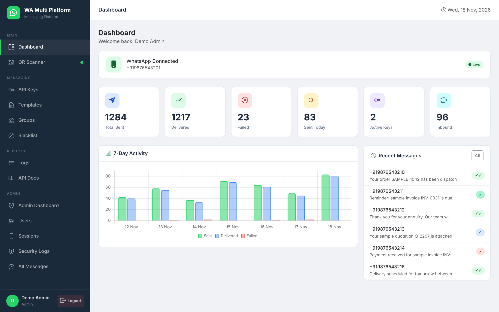
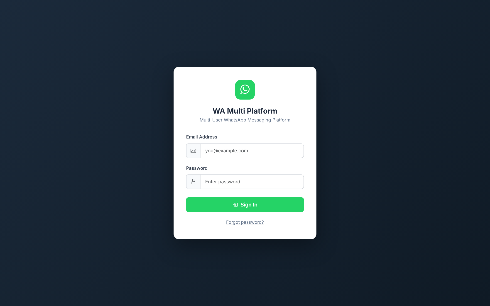
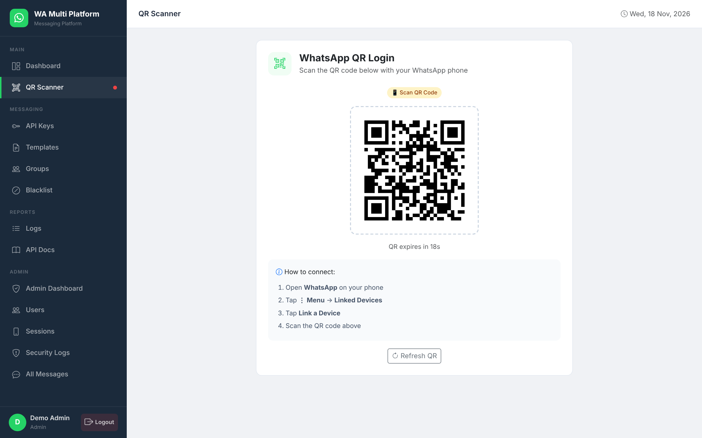
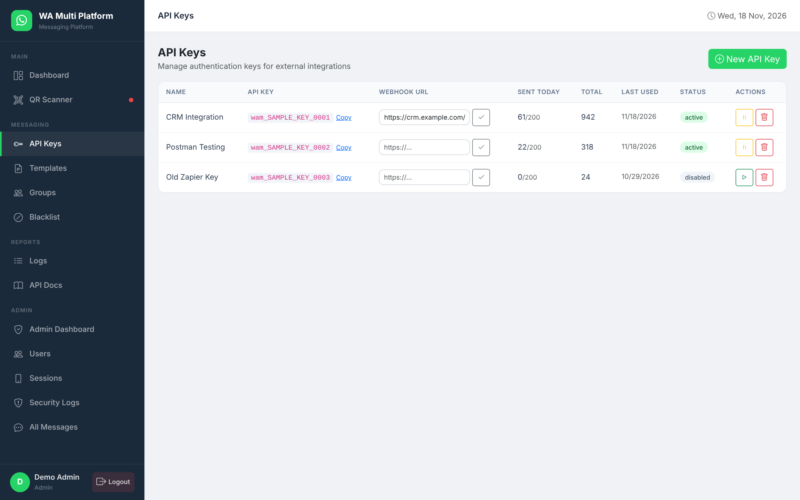
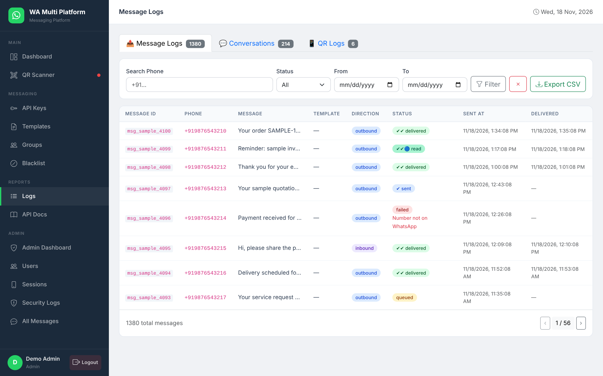
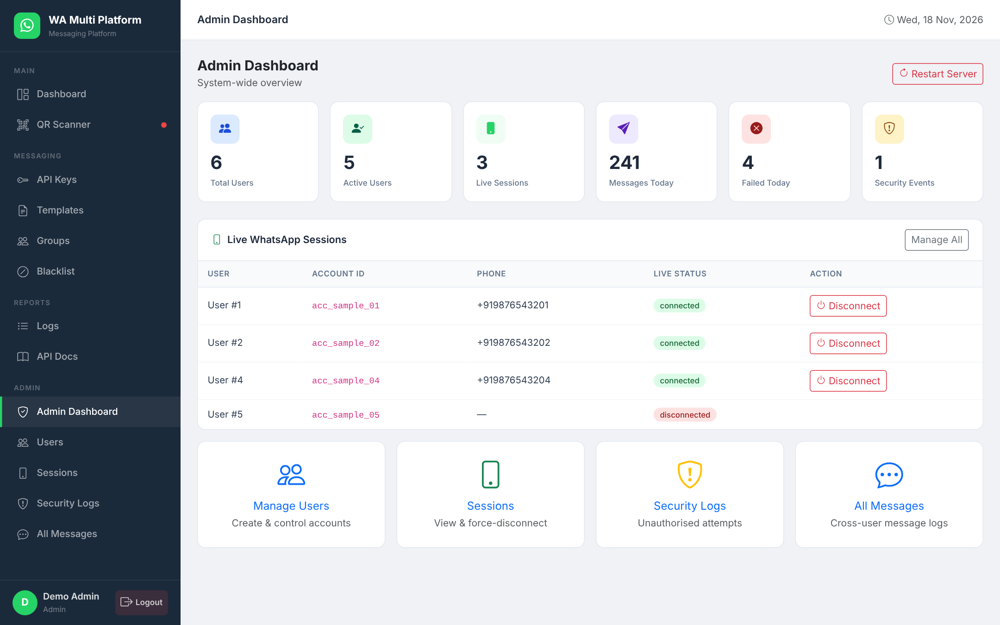
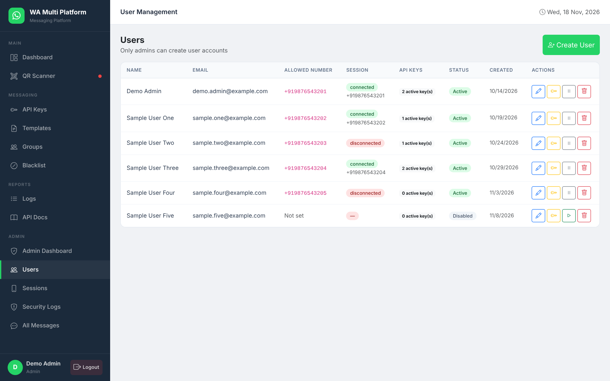
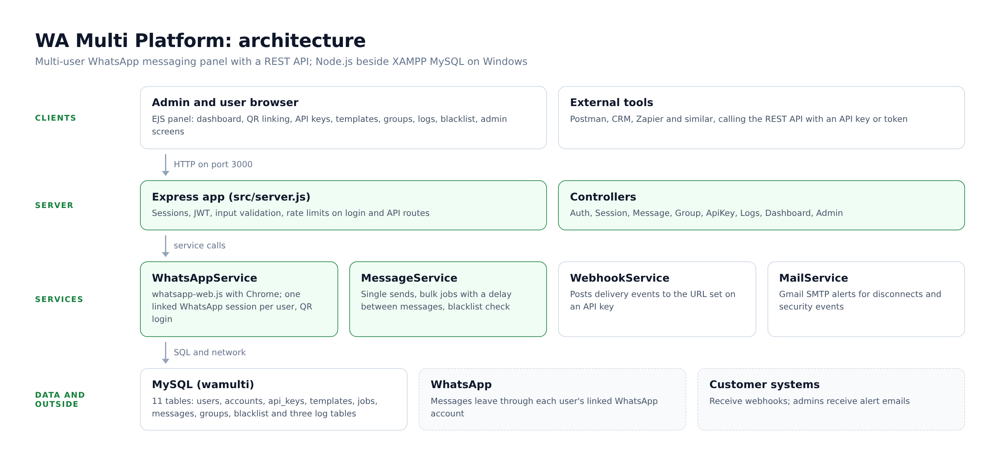
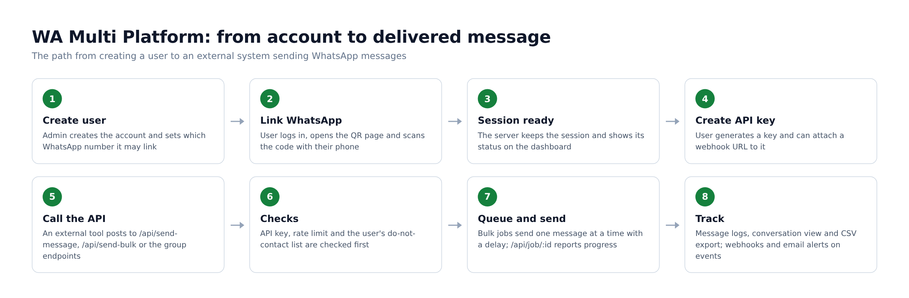

# WA Multi Platform: Multi-User WhatsApp Messaging Panel and API

A multi-user WhatsApp messaging panel with a REST API, built at Eleczo India Pvt. Ltd. Each user links their own WhatsApp account by scanning a QR code, creates API keys, and then sends messages from other systems such as a CRM or Postman.

> **Showcase repository.** This repo contains documentation only. The source code is private because it belongs to my employer. Screenshots use sample data.

## Screenshots

**Dashboard and sign-in**

  
  

**QR login.** Each user links their own WhatsApp account by scanning a short-lived QR code.

**API keys.** Keys with a daily limit, usage counts, an optional webhook URL, and enable, disable and delete controls.

**Message logs.** Every message with its status, search and filters by phone, status and date, and CSV export.

**Admin: system overview and users.** Live session status with force-disconnect, system-wide counts, and user accounts with the WhatsApp number each user is allowed to link.

  
  

## At a glance

| | |
|---|---|
| **Type** | Internal messaging platform with a web panel and REST API |
| **Backend** | Node.js, Express |
| **WhatsApp** | `whatsapp-web.js` driving Chrome, one session per user |
| **Views** | EJS server-rendered pages |
| **Database** | MySQL (11 tables) |
| **Auth** | Sessions for the panel, API keys and JWT for the API |
| **Alerts** | Gmail SMTP through Nodemailer, outbound webhooks |
| **Deployment** | Windows, beside XAMPP MySQL, port 3000 |

## The problem

Several teams needed to send WhatsApp messages from their own tools, each from their own number, without sharing one phone or one login. An admin also had to see who was connected, what was being sent, and be told when a session dropped.

## What I built

**For users**

- QR page to link a WhatsApp account, with live session status.
- API keys with enable, disable and delete, and an optional webhook URL per key.
- Single, bulk and group messaging through the API or from the panel.
- Message templates.
- Message logs with a per-contact conversation view, resend and CSV export.
- A do-not-contact list (blacklist) that blocks sends to listed numbers.
- Built-in API documentation page and a Postman collection.

**For admins**

- Create, edit, disable and delete users, reset passwords, and set which WhatsApp number each user may link.
- View all sessions and force a disconnect.
- All messages across users, security logs, health check and server restart.

## Architecture

## How it works

## API summary

| Method | Endpoint | Purpose |
|---|---|---|
| POST | `/api/auth/token` | Get a token |
| POST | `/api/send-message` | Send one message |
| POST | `/api/send-bulk` | Queue a bulk job |
| GET | `/api/job/:jobId` | Bulk job progress |
| GET | `/api/logs` | Message logs |
| POST | `/api/logs/:messageId/resend` | Resend a message |
| POST | `/api/fetch-groups`, GET `/api/groups` | Sync and list groups |
| POST | `/api/send-group-message`, `/api/send-multi-group` | Send to one or several groups |
| GET | `/api/health` | Health check |

## Technical highlights

- **One WhatsApp session per user.** A service class manages a separate browser-backed client for each account, handles QR generation, reconnects and disconnects, and records QR events.
- **Bulk sending as background jobs.** A bulk request returns a job ID and an estimated duration straight away. Messages are then sent one at a time with a configurable delay, never less than one second, and progress is stored in the `jobs` table.
- **Checks before every send.** API key validity, rate limits and the user's blacklist are all checked before a message is queued, and failures return specific error codes.
- **Two kinds of authentication.** Browser sessions protect the panel; API keys and JWT protect the API. Login and API routes have separate rate limits.
- **Observability.** Message, QR, admin and webhook activity each have their own log table. Email alerts go out on session disconnects and security events, and webhooks notify the calling system.
- **Windows-friendly operations.** A start script checks Node.js, installs packages and starts the server; a restart script and a password-fix script cover the common support cases.

## Known limitations and next steps

- `whatsapp-web.js` automates WhatsApp Web and is not an official WhatsApp API, so it can break when WhatsApp changes and carries a risk of numbers being restricted. The official WhatsApp Business Platform is the long-term route for production volumes.
- Bulk jobs run in the server's memory, so a restart interrupts a running job. A persistent queue would fix this.
- Each linked account runs a Chrome instance, which limits how many users one machine can hold.

## Skills demonstrated

Node.js and Express, REST API design, session and token authentication, background job handling, MySQL schema design, EJS templating, webhook and SMTP integration, rate limiting and input validation, Windows deployment and installation documentation.

## Contact

- Email: deepatil0212@gmail.com
- LinkedIn: [linkedin.com/in/deepa-patil-332925345](https://www.linkedin.com/in/deepa-patil-332925345)
